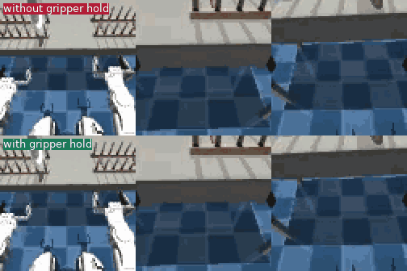

# G1 plate transfer: privileged-expert distillation into an image policy



*Top: a stall-breaker kick opens the gripper mid-hold and the plate drops. Bottom: gripper hold enabled, same seed
(7770042) and weights, task completed. 4x speed; frames are the policy's three 84x84 camera views (head, right wrist,
left wrist).*

A Unitree G1 picks a plate from rack 1 and places it in any of the six slots of rack 2. The policy is a ResNet18
behaviour-cloning model over the three cameras and proprioception, predicting 20-step action chunks. It is trained by
distilling a privileged scripted expert, and uses a small observation-only stall breaker at inference.
Weights: `submission/weights/final.pt` (57 MB, sha256 `92f0318cad607e9db7e2a087a8890b524713c018564deaf2b91c5b4541e0c67f`).
`make_policy()` loads them with no environment variables.

## Results

**2,991 / 3,000 successes (99.7%, Wilson 95% interval 99.4-99.8%)** on 3,000 fresh seeds (7,900,000-7,999,999, ten
disjoint blocks of 300), via the unmodified `advaitic-eval`, balanced over the six source slots, with 0 falls,
0 policy errors and integrity checks passed. The public qualifying block (27/30 required) scores 30/30.

| Run | Seeds | Trials | Success | Wilson 95% | Report |
|---|---|---|---|---|---|
| **Certification (shipped policy)** | 7,900,000 + k*10,000, k=0..9 | 3,000 | **2,991 (99.7%)** | 99.4-99.8% | `reports/final_hold/h3_hold_B79*.json` |
| Public block, qualifying run, with video | 7,310,000+ | 30 | **30 (100%)** | - | `reports/final_hold/final_hold_public30.json` |
| Screen, without gripper hold | 7,800,000 + k*10,000, k=0..3 | 600 | 594 (99.0%) | 97.8-99.5% | `reports/final_hold/h2_base_B78*.json` |
| Screen, shipped policy | same 600 seeds | 600 | 598 (99.7%) | 98.8-99.9% | `reports/final_hold/h2_hold_B78*.json` |
| Previous version (no gripper hold) | 7,700,000 + k*10,000, k=0..9 | 3,000 | 2,970 (99.0%) | 98.6-99.3% | `reports/final_v5/cert3000_*.json` |

Per source slot in the certification run (out of 500 each): slot 1: 499, 2: 500, 3: 500, 4: 498, 5: 498, 6: 496.
The 9 misses are 8 timeouts and 1 early termination without a fall: seeds 7900129, 7930139, 7940032, 7950209,
7950240, 7950286, 7970183, 7970247, 7980162.

## Approach

- **Observations / actions.** Three 84x84 RGB cameras and 50-d proprioception in; a 20-d absolute action out (4 base
  commands, 14 arm joint targets, 2 grippers), predicted as a 20-step chunk and executed in full before re-planning.
  No simulator state, seed or slot index is used at inference.
- **Model** (`model.py`, `bc_policy.py`). One ResNet18 shared over the three cameras, concatenated with normalised
  proprioception, MLP head, L1 loss, random-shift augmentation, EMA weights, 150k steps at batch 128.
- **Privileged expert** (`expert.py`). A closed-loop scripted pick-and-place that reads the simulator's true plate and
  rack poses and uses IK on the actual hand. Phases: raise arm, walk to standoff, settle, approach the plate's near
  rim, pinch, lift, strafe, damp gait sway, align by arm feedback, lower, release, retreat. It is used only to
  generate training data and never during evaluation.
- **Data.** 60 provided human demonstrations, plus successful expert episodes from seeds 5,000,000 and up (disjoint
  from every evaluation block): 710 new and 200 earlier episodes, comprising 314 clean episodes on hard rack
  configurations (large x offset, slots 3-6), 396 DART episodes (brief noise bursts on the base and left-arm commands
  while the expert keeps its own command integrator, so labels stay clean and teach recovery), and 200 clean
  episodes sampled from earlier data.
- **Stall breaker** (`bc_policy.py`, observations only). A deterministic single-frame policy can sit in a fixed
  point, for example gripper closed with the arm frozen after the grasp, or hovering a few cm from the slot. If arm
  and gripper joints change by less than 0.02 (normalised) for 3 consecutive replans, noise of random strength is added
  to the proprioceptive input.
- **Gripper hold** (`BC_HOLD_GRIP`, default on). While a kick is active and the gripper is closed, the previous
  gripper command is kept, so a kick can move the arm but cannot release the plate. Replays showed that without it
  the kick could open the gripper while the plate was held 3-6 cm from the slot, dropping it
  (`media/seed7770042_hold_off.mp4` vs `_on.mp4`).

## Development summary

| Step | Result (execute 20) |
|---|---|
| 60 human demos only | 78% (47/60) |
| + 298 expert episodes | 95-98% |
| + 1,329 expert episodes, slots 4-6 oversampled (`cr_all`) | 98.9% (267/270) |
| Miss diagnosis, stall breaker, hard-config + DART data (`cr_v5`) | 99.0% (2,970/3,000) |
| + gripper hold (shipped) | 99.7% (2,991/3,000, different seeds) |

Execute length matters for a single-frame policy: early weights scored 50% / 73% / 90% at execute 5 / 10 / 20.
The individual contributions of the DART data, hard-configuration data, longer training and stall breaker to the
`cr_v5` gain were not separated. The full run log, including invalid and negative runs, is in `EXPERIMENTS.md`.

### Ablations

- **Discrete vs continuous action heads** (idea from arXiv:2610.20429). A simplified discrete head (MLP, 256 bins) was
  much worse than the continuous head (35% vs 98% at execute 20). A DiT discrete-flow head (512 bins, 20 flow steps)
  scored 108/120 vs 116/120 for the continuous L1 head at execute 20 (Fisher p = 0.067, not significant), with about
  5% of the paper's sample budget. Its advantage appears when re-planning often: at execute 5 it scores 48/60 vs 29/60
  (p = 0.0005), at execute 10 it is 50/60 vs 47/60. The continuous head is saturated at execute 20, so the shipped
  policy keeps the continuous head.
- **Negative results.** DAgger round 1 with labels anchored to the student's own command; 50-step chunks (equal);
  pi0.5 zero-shot and a 5k-step fine-tune (0/30); constant-noise DART (broke the expert's phase switches); and a
  second round of extra place-phase perturbation data (`cr_v6`, 592/600, worse than `cr_v5` on the same seeds).

## Failure analysis

Misses were replayed with read-only privileged probes (`scripts/diagnose_miss.py`). Before the gripper hold, 30 of
3,000 trials failed (19 on slot 6, 9 on slots 4-5), in four patterns: (1) freeze right after the grasp, resolved by
the stall breaker; (2) hover 3-6 cm from the slot for 80-220 steps, after which a kick opened the gripper and the
plate dropped about 10 cm (5 of the 7 replayed slot-6 misses), addressed by the gripper hold; (3) release a few cm off
the slot, leaving the plate misaligned; (4) a drop at placement time leaving the plate flat. Patterns 3 and 4 and the
hover itself are not fixed, only made non-fatal. 8 of the 9 remaining misses are on slots 4-6.

## Evaluation protocol and limitations

- Training uses expert seeds 5,000,000-5,007,999 and the 60 provided demonstrations only; `generate_data.py` refuses
  the public seed range.
- The certification seeds (7,900,000+) were fixed and recorded in `reports/prereg/PREREG_hold.txt` before any result
  and were not used for diagnosis or tuning. The 7,700,000 and 7,800,000 blocks are development data: the gripper hold
  was designed from misses on the former and screened on the latter.
- The comparison between the previous version (99.0% on 7,7xx seeds) and the shipped one (99.7% on 7,9xx seeds) is
  across different seeds (Fisher p about 0.001). The paired screen on identical 7,8xx seeds (594 vs 598 of 600) is not
  significant by itself.
- The public block was inspected during development (the execute length was chosen there), so the 3,000-trial run is
  the figure to use.
- Results are from runs of the supplied evaluator by the author, not an independent re-run. The pytest suite checks the
  evaluator only and does not demonstrate task success.

## Future work

Analyse the 9 remaining misses; history-conditioned input (frames or previous action) to avoid the hover fixed point;
a discrete-flow head trained on the final data and re-planned every 5-10 steps; a release gate or critic; repeated
training seeds to measure run-to-run variance.

## Reproduce

All commands run from the repository root on Linux with an NVIDIA GPU (CPU inference also works: `BC_DEVICE=cpu`).

### 1. Environment

```bash
uv sync --locked --extra video                      # simulator + evaluator, pinned by uv.lock
uv run bigym-download --task move_plate             # task assets
# torch env that also has the simulator (policy process); see PROBLEM.md for details
uv venv --python 3.11 .venv-train
uv pip install --python .venv-train/bin/python -r submission/requirements-train.txt
uv export --frozen --no-hashes --no-emit-project > /tmp/req_locked.txt
uv pip install --python .venv-train/bin/python -r /tmp/req_locked.txt
sha256sum submission/weights/final.pt               # expect 92f0318c...c0deaf2b91c5b4541e0c67f (see top of this file)
```

### 2. Public qualifying run (30 trials, first 3 recorded)

```bash
BC_DEVICE=cpu MUJOCO_GL=egl uv run advaitic-eval --policy submission.bc_policy:make_policy \
  --policy-python .venv-train/bin/python --episodes 30 --seed-start 7310000 --video-episodes 3 \
  --out results/final_public30
```

Expected: 30/30 successes (`required_successes` 27). The evaluator is deterministic for a fixed seed, but GPU vs CPU
inference can differ in the last bits, so an individual episode may differ; the success rate should not.

### 3. The 3,000-trial certification run (10 blocks in parallel on one RTX 4090 take about 45 minutes)

```bash
bash submission/scripts/repro_cert.sh 10     # argument = blocks run in parallel
```

Runs seeds 7,900,000 + k*10,000 (k=0..9), 300 trials each, and prints the pooled count, per-slot counts, Wilson interval
and every miss. Expect about 2,985-2,995 successes (reference run: 2,991); the block-to-block spread is large (0 to 3
misses per 300), so individual blocks vary. To switch the gripper hold off: `BC_HOLD_GRIP=0`.

For a clean run from an isolated copy (the evaluator hashes the policy folder, so files changing during a run invalidate
it; training also rewrites `checkpoints/`), use `submission/scripts/snap_eval.sh NAME CKPT EXECUTE EPISODES SEED_START`.

### 4. Retrain the policy (results will not be bit-identical)

```bash
# privileged-expert data (seeds never in an evaluation block); ~22 MB per episode
MUJOCO_GL=egl uv run python -m submission.generate_data --start-seed 5000000 --count 640 --workers 12 --out datasets/expert_train
MUJOCO_GL=egl uv run python -m submission.generate_data --start-seed 5003000 --hard 320 --out <dir>   # clean, hard configs
MUJOCO_GL=egl uv run python -m submission.generate_data --start-seed 5004000 --count 700 \
  --dart 0.03,0.08 --out <dir>                                                                         # DART bursts
MUJOCO_GL=egl uv run python -m submission.export_demos --out datasets/move_plate.npz                    # 60 human demos
.venv-train/bin/python -m submission.pack_data --demos datasets/move_plate.npz --expert-dir <staged dir> --out <packed>
.venv-train/bin/python -m submission.train --packed <packed> --head continuous \
  --boost-slots 3,4,5 --boost 2.0 --steps 150000 --out <ckpt dir>
BC_CHECKPOINT=<ckpt dir>/last.pt uv run advaitic-eval ...     # evaluate your own checkpoint
```

Training data and checkpoints are not committed (`datasets/`, `checkpoints/` are git-ignored; the packed set is about 47 GB); `EXPERIMENTS.md` lists every run, including negative and invalid ones.

### 5. Checks required by the repository

```bash
uv run ruff check src submission tests
uv run ruff format --check src submission tests
ORT_DISABLE_TELEMETRY=1 MUJOCO_GL=egl uv run pytest -q
```

## Media

| File | What it shows | Source |
|---|---|---|
| `media/hero.gif` | The two `seed7770042_hold_*` clips stacked, 4x speed | built with ffmpeg from the clips below |
| `media/public_episode_00{0,1,2}.mp4` | First three public-block episodes of the shipped policy (seeds 7310000-7310002, source slots 5, 2 and 1; all successes) | evaluator recordings, `reports/final_hold/final_hold_public30.json` |
| `media/seed7770042_hold_off.mp4` / `_on.mp4` | Same seed (slot 6), same weights: without the gripper hold the plate is dropped and the run times out; with it the task completes | in-process clip (`scripts/record_clip.py`), not an evaluator run |
| `media/seed7520101_breaker_off.mp4` / `_on.mp4` | Without the stall breaker the policy freezes after the grasp; with it, one kick and the task completes | in-process clip |
| `video/cr_all_demo.mp4` | Older `cr_all` demo, includes a failure that does not recover | evaluator clips, `scripts/make_video.py` |

Each frame is the policy's three views (head, right wrist, left wrist), 84x84 each, recorded every 5th step.

## Attribution

- BiGym2 environment and task (pinned upstream commit in `src/advaitic_eval/upstream_manifest.json`), the frozen
  GR00T whole-body Balance/Walk controller, the starter evaluator, and MuJoCo: provided by the assignment.
- PyTorch / torchvision (ResNet18, trained from scratch), uv, ruff, pytest.
- LeRobot and `lerobot/pi05_base` (pi0.5): used only for the reference VLA runs (zero-shot and 5k-step fine-tune), not
  in the shipped policy. Discrete-head experiments follow the idea in arXiv:2610.20429 (own implementation).
- Human demonstrations: the 60 provided with the task.
- AI tooling: Claude Code (Anthropic) was used for coding, running experiments and analysis in this repository.
  The candidate is responsible for understanding and maintaining the solution.
